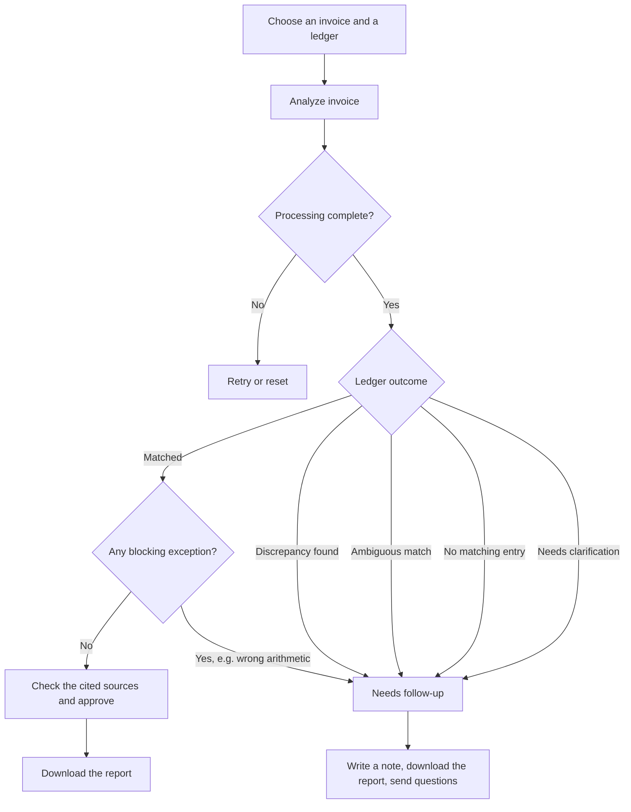

# TaxFlow: technical details

TaxFlow checks whether each client invoice agrees with the client's accounting records and prepares an
exception report for an analyst to review. It reads the invoice, extracts the key fields with a cited source line
for each value, finds the matching ledger entry, compares the two in Python, and checks the invoice's own
arithmetic. The analyst makes the final decision.

On 500 held-out synthetic invoice images, TaxFlow extracted 95.6% of labeled fields correctly, compared with
88.3% for a regex baseline on the same OCR text. On generated ledgers of up to 100,000 rows, the matching
engine routed 3,000 of 3,000 labeled queries correctly. Details and limits are in [Benchmarks](#benchmarks).

TaxFlow is an independent prototype and implies no affiliation with any firm. All data is synthetic. It does
not file taxes, calculate tax liability, pay invoices, post journal entries, certify compliance, or send messages.

- Repository: https://github.com/alyssaqle/taxflow-reconciliation
- Public demo: not yet confirmed (see [Deployment](#deployment))

## An example

An invoice states a subtotal of 800.00, tax of 80.00, and a total of 950.00. The ledger records a gross amount
of 950.00. TaxFlow reports two separate results:

- Ledger reconciliation is *Matched*, because the stated total equals the gross amount.
- Invoice arithmetic is *Inconsistent*, because 800.00 + 80.00 = 880.00 and the stated total is 70.00 higher
  (`TOTAL_MISMATCH`, blocking).

TaxFlow never replaces the stated total with the calculated one. Approval stays disabled and the recommended
decision is *Needs follow-up*.

## The user and the problem

### The problem

Before invoices feed into month-end close, tax work, or an audit, someone has to confirm that each invoice agrees with how the
client recorded it. That means finding the right ledger entry, comparing the vendor, number, date, currency,
and amount, checking that the invoice's own math adds up, and writing down anything that needs follow-up. The
work is repetitive, but a mistake is expensive: approving a mismatched invoice puts a wrong number into
everything downstream.

Two things make it harder than it looks. The same invoice can be wrong in two independent ways (it can
disagree with the ledger, or disagree with itself), and a reviewer has to show where each number came from, not
just state it.

### Persona

Jordan is a hypothetical user, described from how invoice review generally works rather than from interviews.

| | |
|---|---|
| Role | Finance or accounting operations analyst at a mid-size company or an accounting firm |
| Works with | Batches of vendor invoices (PDFs and scans) and a ledger export from the client's accounting system |
| Today | Searches the spreadsheet for each invoice number, compares fields by eye, recalculates totals with a calculator, and writes notes by hand |
| Pains | Look-alike entries (same amount, one digit off in the number), duplicate postings, invoices whose own math is wrong, and having to show where every number came from |
| Good outcome | Every exception is caught, each note points to a source line and a ledger row, and clean invoices take little time |
| Deal-breaker | A tool that approves a wrong match, invents a value, or hides why it reached a conclusion |

### Jobs to be done

Main job: when a batch of invoices arrives with the ledger export, Jordan wants to know which invoices agree with
their entries and exactly what is wrong with the rest, so they can close the review and send precise questions
to the client or vendor.

Smaller jobs inside it:

- Find the ledger entry that belongs to this invoice, or learn that there isn't exactly one.
- Confirm that the vendor, number, date, currency, and amount agree.
- Check that the invoice's own totals add up.
- Record what is wrong and what to ask, in words a client can act on.
- Be able to defend the decision later to a manager, an auditor, or the client.

The last job matters as much as the others. Jordan's work is reviewed, so a correct answer without a trail is
not enough.

### What Jordan needs from a tool

| Need | How TaxFlow meets it | Status |
|---|---|---|
| Never approve a wrong match | Exact matching on invoice number and vendor; any blocking exception disables Approve; a person makes the decision | Built |
| See where every number came from | Each extracted value cites a source line that Python verifies; the compared ledger row is shown by ID and CSV row | Built |
| Catch both kinds of error | Ledger reconciliation and invoice arithmetic are separate results | Built |
| Know what to ask next | Each exception comes with follow-up text tied to a policy rule | Built |
| Leave a record | Review note, decision, and JSON or CSV export with every finding | Built |
| Move fast on clean invoices | Approve is one click when nothing blocks | Built; time savings not measured |
| Work from PDFs and whole batches | The app takes one TXT invoice at a time | Not built |

### User flows

Today, without a tool:

1. Open the invoice and the ledger spreadsheet side by side.
2. Search the spreadsheet for the invoice number, then check that the vendor matches.
3. Compare the date, currency, and amount by eye.
4. Add up the invoice's lines and tax with a calculator.
5. Write a note and decide, then repeat for the next invoice.

With TaxFlow:



What Jordan sees and does for each outcome:

| Outcome | What Jordan sees | What Jordan does next |
|---|---|---|
| Matched, nothing blocking | Fields with sources, the ledger row, every comparison agreeing | Spot-check a source line and approve |
| Matched, arithmetic wrong | The ledger agrees, but the invoice's own total doesn't add up | Ask the vendor to confirm or correct the invoice |
| Discrepancy found | Which field differs (amount, currency, or date) and by how much | Ask the client to confirm the recorded value |
| Ambiguous match | Every candidate entry; none is chosen for Jordan | Ask the client which entry is right, or whether one is a duplicate |
| No matching entry | That no entry has this number and vendor | Ask whether the invoice was recorded |
| Needs clarification | Which required field is missing | Request the missing information |
| Processing failed | An error, never a made-up result | Retry, or review the invoice manually |

### What this is based on

I haven't interviewed analysts or used client data, so the persona and the problem statement are hypotheses.
What I can show is evidence about the parts of the problem that can be tested without clients:

- Extraction is hard enough to need care. On FATURA's synthetic invoice images, a regex baseline got every
  required field right on only 58.6% of invoices. The first version of my own pipeline scored 49.4% on the
  development set before the OCR and prompt fixes.
- Matching has traps that a quick look misses: entries with the same amount but a different invoice number,
  the same number under another vendor, and duplicate postings. The ledger benchmark includes all three.

Whether TaxFlow saves reviewers time is still unknown. The timing pilot in [pilot/](pilot/) is built but has not
been run.

## Product decisions

### How I prioritized

I ranked risks by the cost of being wrong for a reviewer: approving something incorrect is worst, missing an
issue is next, and slow review is last. That ordering drove most decisions.

- Python makes every comparison, and the model never decides a match. Arithmetic and matching need to be exact
  and repeatable, so they're deterministic code. The model's job is reading the document and choosing which
  checks to run.
- Matching is exact on invoice number and vendor, with no fuzzy matching, and an equal amount never selects an
  entry. A wrong match is worse than an "Ambiguous match" that asks a person to decide.
- Every value cites its source line, and Python verifies the quote. A reviewer can check a claim in one click
  instead of trusting it.
- A person approves, and blocking exceptions disable approval. The tool prepares the decision; it doesn't make
  it.
- I narrowed the scope twice. The first plan covered invoices, W-2s, and 1099s at once; I cut it to invoices.
  Then I changed the product from single-invoice intake to invoice-to-ledger reconciliation, because comparing
  two sources is closer to what the review actually needs. PDF input, field editing, fuzzy matching, and
  currency conversion are deliberately left out until the core review is proven.
- Evaluation came early. Each stage had a frozen held-out set before I looked at results, so the numbers in
  this README weren't tuned on the data they report.

### Why these tools

| Tool | Why |
|---|---|
| Python, `Decimal`, Pydantic | Exact money arithmetic and typed records that reject malformed model output |
| Azure OpenAI (`gpt-4.1-mini`) | Function calling and strict JSON output in a cloud that enterprise teams commonly use; the small model kept a 500-document benchmark at about 1.4M tokens |
| Streamlit | A working review screen in Python, with free hosting for a public demo |
| `pycountry` | A maintained ISO 4217 currency list instead of a hand-typed one |
| Tesseract, FATURA | A free, local OCR engine and an openly licensed (CC BY 4.0) invoice dataset, so extraction could be tested on documents I didn't write |

### How TaxFlow addresses it

TaxFlow does the lookup and comparison work and leaves the judgment to the reviewer. For each invoice it shows
the extracted fields with their source lines, the ledger entry it compared against, a side-by-side table, and a
short list of exceptions with the follow-up each one needs. The ledger result and the invoice's own arithmetic
are reported separately, so the 950 vs 880 case above surfaces both problems instead of one. If the review is
incomplete, approval stays off.

## Status

| Requirement | Implemented | Offline tests | Live verified | Deployed |
|---|---|---|---|---|
| v1 invoice intake (tag `v1-invoice-intake`) | Yes | Yes | Yes, Azure OpenAI `gpt-4.1-mini` | No |
| Ledger CSV validation, template, sample ledger | Yes | Yes | Yes | Pending |
| Matching, comparison, outcomes, separate arithmetic check | Yes | Yes | Yes, 11 development samples recorded | Pending |
| Agent with 5 tools, outcome-dependent required tools, 8-request budget | Yes | Yes | Yes | Public demo replays recorded runs only |
| Reconciliation UI, review decision, JSON and CSV export | Yes | Yes | Yes | Pending |
| Benchmarks: 29-case workflow set, 500 FATURA documents, ledger scale | Yes | Yes | Yes | n/a |
| Reviewer timing pilot | Tools only | Yes | Not run | n/a |

## Workflow

1. Choose a synthetic invoice and the sample ledger. In local live mode you can upload a TXT invoice and an
   accounting CSV instead.
2. The agent extracts the vendor, invoice number, invoice date, currency, and stated total, plus the subtotal, tax,
   and line items for the arithmetic check. Each value cites a page, a line range, and an exact quote, and Python
   verifies the quote against the source.
3. Python searches the ledger, compares the invoice with the single matching entry, and checks the arithmetic.
4. The report shows the extracted fields, the ledger entry with its ID and CSV row, a side-by-side comparison,
   the exceptions, and follow-up steps that cite policy rules.
5. The analyst adds a note, chooses Approve or Needs follow-up, and downloads JSON or CSV.

TaxFlow keeps four statuses separate:

| Status | Values | Meaning |
|---|---|---|
| Processing | Complete, Failed, Incomplete | Whether the run finished. A failed run is never shown as a result. |
| Ledger reconciliation | Matched, Discrepancy found, No matching entry, Ambiguous match, Needs clarification, Unsupported document, Incomplete | What the ledger comparison found |
| Invoice arithmetic | Consistent, Inconsistent, Partially checked, Not checked | The invoice's own math, independent of the ledger |
| Human review | Unreviewed, Approved, Needs follow-up | The analyst's decision. A note never removes a finding. |

Approve is enabled only when processing is Complete and there are no blocking exceptions. A new invoice, a new
ledger, or a re-run resets the decision.

## Accounting CSV

```
ledger_entry_id,invoice_number,vendor_name,invoice_date,currency,gross_amount
```

The app offers the template and a fictional sample ledger for download; both are also in
[samples/ledger/](samples/ledger/). TaxFlow validates the whole file before processing and rejects it if any
check fails:

- exact column names, with no duplicates or extras;
- `YYYY-MM-DD` dates;
- supported ISO 4217 currencies, from the maintained `pycountry` list minus metals, test codes, and fund codes;
- a nonnegative `gross_amount` with at most two decimals and no thousands separators;
- a unique `ledger_entry_id`, and a non-empty invoice number and vendor;
- UTF-8, at most 2 MB and 5,000 rows.

`gross_amount` includes tax. Each invoice is assumed to have one ledger entry. Split postings and credit notes
are out of scope, and a credit note is routed as an unsupported document.

## Matching and comparison rules

The rules are in [taxflow/matching.py](taxflow/matching.py).

- A ledger entry is a candidate when its invoice number and vendor name both equal the invoice's after trimming,
  collapsing whitespace, and ignoring case. Nothing else is normalized and nothing is fuzzy-matched. An equal
  amount never selects a record. All candidates are returned.
- With one candidate, TaxFlow compares the currency first and never converts it. If the currencies differ, it
  doesn't compare the amounts, and the mismatch blocks approval. Otherwise it compares the stated total with
  `gross_amount` using `Decimal` (a difference of 0.01 or less agrees), then compares the dates.
- *Matched* requires all three comparisons to complete and agree. If one can't run, for example because the
  invoice date is missing, the outcome is *Needs clarification*.
- Several candidates give *Ambiguous match*, and none is selected. No candidate gives *No matching entry*. A
  missing invoice number or vendor gives *Needs clarification*, and the ledger is not searched.

Required fields and blocking:

- The required fields are the vendor, invoice number, invoice date, an explicitly stated supported currency (a
  "$" sign alone doesn't count), and the stated total. A missing required field blocks approval.
- Subtotal, tax, and line items only feed the arithmetic check. If they're missing, the arithmetic is *Not
  checked* or *Partially checked*, and a non-blocking `ARITHMETIC_NOT_CHECKED` note appears in the report and
  the export. Discounts, shipping, and similar adjustments add a non-blocking `UNSUPPORTED_STRUCTURE` note.
- All other exceptions block approval: ledger exceptions, arithmetic mismatches, invalid or ambiguous values, and
  unverified evidence. Follow-up text comes from
  [policies/reconciliation_policy.md](policies/reconciliation_policy.md), a fictional policy with stable
  `TF-POL-xxx` IDs.

## Agent and tools

```
 invoice TXT ─► parsing (pages, numbered lines) ─► Azure OpenAI extraction (strict json_schema) ─► evidence verification
 ledger CSV  ─► ledger validation and lookup index ──────────────────────────────┐
                                                                                 ▼
  model function calls ─► Python tools (allowlisted, session-scoped, read server-side state only)
    validate_intake         required fields, ISO currency, dates, amounts, evidence
    reconcile_invoice       invoice arithmetic (separate check)
    find_ledger_candidates  exact invoice number + vendor → all candidates
    compare_to_ledger       only for the single candidate Python returned
    build_review_checklist  outcome + policy-referenced follow-up from Python findings
                                                                                 ▼
  report (Python findings are authoritative) ─► human note + decision ─► JSON / CSV
```

- Which tools must succeed depends on the outcome. `compare_to_ledger` is required only when exactly one
  candidate exists. With no candidate, several candidates, or a missing identifier, the run finishes on the
  follow-up path. If the model tries to compare a different entry, the call is rejected and doesn't count.
- Each invoice gets at most 8 model requests, counting extraction, schema repair, tool rounds, and at most one
  transient retry. One response can request several tools, and typical runs use 4 or 5 requests. A run that
  exhausts the budget is *Incomplete* and can't be approved.
- The report keeps a model-written sentence only if it cites a real finding code or policy reference.
- Text inside a document is treated as data. Tools outside the allowlist are rejected, and the model can't
  change the review status.

## Modes

| Mode | What happens | Where |
|---|---|---|
| Recorded live run | Replays saved Azure runs of the 11 development samples, with provider, model, and time. No inference. | Public demo (default) |
| Illustrative demo | Uses a hand-prepared extraction, labeled as such. The ledger search, comparison, and arithmetic are real Python. | Always |
| Live agent | Runs inference and model-chosen tool calls, with TXT and CSV upload. | Local or private only (`LIVE_MODE_ENABLED=true`) |

## Local setup

TaxFlow needs Python 3.12 (tested on 3.12.2). Package versions are pinned in `requirements.txt`.

```bash
python3.12 -m venv .venv && source .venv/bin/activate
pip install -r requirements-dev.txt
python -m streamlit run app.py      # open the http://localhost:8501 URL it prints
python -m pytest                    # 66 offline tests; no network or key needed
```

For live mode, copy `.streamlit/secrets.example.toml` to `.streamlit/secrets.toml` (git-ignored) and set:

- `AZURE_OPENAI_BASE_URL`: `https://<resource>.openai.azure.com/openai/v1/` or the `.services.ai.azure.com` form
- `AZURE_OPENAI_API_KEY`
- `AZURE_OPENAI_DEPLOYMENT`
- `LIVE_MODE_ENABLED = "true"`

The deployment must support Chat Completions with function calling and strict `json_schema`. TaxFlow was
verified on `gpt-4.1-mini`.

```bash
RUN_LIVE_TESTS=1 python -m pytest tests/live -q   # live smoke test: the 950 vs 880 sample
python -m taxflow.record                          # re-record the sample replays
python -m evaluation.run --mode live              # 29-case workflow benchmark (paid)
```

## Benchmarks

| Benchmark | Data | Main result | Report |
|---|---|---|---|
| Field extraction from invoice images | 500 FATURA documents: synthetic invoices from 40 templates not used during tuning | 95.6% of fields correct (2,371/2,481) vs 88.3% for a regex baseline | [TaxFlow](reports/fatura-eval-live-20261001T200811Z.md), [baseline](reports/fatura-eval-baseline-20261001T200818Z.md) |
| Ledger matching at scale | Generated ledgers of 1,000, 10,000, and 100,000 rows, with 1,000 constructed queries each | 3,000/3,000 queries routed correctly, 0 false or missed matches | [ledger-scale](reports/ledger-scale-20261001T202245Z.md) |
| End-to-end workflow | 29 synthetic invoices written for this project, with their own ledger | 29/29 workflows correct | [first run](reports/eval-v2-20261001T070337Z.md), [regression](reports/eval-v2-20261001T200521Z.md) |
| Reviewer time savings | None yet | Not measured | [pilot instructions](pilot/PILOT_INSTRUCTIONS.md) |

### Field extraction on FATURA

FATURA (Limam, Dhiaf and Kessentini, 2023; [Zenodo](https://doi.org/10.5281/zenodo.8261508); CC BY 4.0)
contains 10,000 synthetic invoice images that its authors generated from 50 templates. TaxFlow used 50
documents from 10 templates for development and 500 documents from the other 40 templates for evaluation. The
pipeline ran on the images: each was upscaled 2× and read with Tesseract 5, and TaxFlow's extraction ran on the
OCR text. The dataset files stay out of this repository; [benchmarks/fatura/manifest.csv](benchmarks/fatura/manifest.csv)
lists the selected documents.

The prompt was frozen at `extract-v6+agent-v2` in commit `39142c9` before the evaluation documents were run.
Both systems were scored on the same 2,481 labeled fields.

| Metric | TaxFlow | Regex baseline |
|---|---|---|
| Field accuracy | 95.6% (2,371/2,481) | 88.3% (2,191/2,481) |
| Invoices with every required field correct | 84.6% (423/500) | 58.6% (293/500) |
| Values invented where the field was absent | 0/197 | 0/197 |
| Extracted values verified against the cited source line | 98.9% (2,529/2,556) | n/a |
| Missing required fields sent to follow-up | 99.5% (196/197) | 100% (197/197) |
| Discount and multi-tax invoices flagged | 97.0% (159/164) | 0/164 |
| Failed requests | 0/500 | 0/500 |
| Latency, OCR plus extraction | median 7.4 s, p95 13.8 s | median 0.5 s |

Two invoices out of 500 were wrongly classified as unsupported documents. Vendor names were the weakest field
at 84.2% (276/328), and invoice numbers were limited by OCR errors such as `/` read as `I`.

The 50 development documents exposed most of the problems. The first pilot scored 49.4% because the original
OCR settings lost much of each page and because invoices with discounts were classified as unsupported. Those
fixes were made on the development documents only, and every pilot report is kept in [reports/](reports/).

These invoices are synthetic and typed, so the result says nothing about scanned or handwritten documents. The
labels come from the dataset's annotations through a mapping fixed before scoring, in
[benchmarks/fatura/labels.py](benchmarks/fatura/labels.py). Fields the annotations don't cover were not scored.
DocILE, a dataset of real business documents, requires an access request that hasn't been made yet.

### Ledger matching at scale

The ledgers and queries are generated with a fixed seed by
[benchmarks/ledger_scale/generate.py](benchmarks/ledger_scale/generate.py); they are not client data. Every ledger
includes duplicate entries and decoys that share a vendor and amount with a real entry but have a near-miss
invoice number. Each query's expected answer comes from how the generator built it, not from running TaxFlow's
matching code.

| Rows | Routing correct | False / missed matches | Lookup median, linear scan | Lookup median, index | CSV load and validation |
|---|---|---|---|---|---|
| 1,000 | 1,000/1,000 | 0 / 0 | 0.084 ms | 0.0012 ms | 0.005 s |
| 10,000 | 1,000/1,000 | 0 / 0 | 0.84 ms | 0.0015 ms | 0.038 s |
| 100,000 | 1,000/1,000 | 0 / 0 | 8.46 ms | 0.0021 ms | 0.48 s |

The index uses the same normalized key as the linear scan, and both returned identical predictions on all 3,000
queries. Building the index for 100,000 rows took 0.14 s. These timings cover Python matching only, on one Apple
Silicon laptop, with no model calls.

### End-to-end workflow set

[evaluation/v2/](evaluation/v2/) has 29 synthetic invoices and a 32-entry ledger:

- 5 correct matches;
- 4 amount differences;
- 3 missing entries;
- 3 duplicate candidates;
- 3 currency differences;
- 3 missing required fields;
- 3 invoices with wrong arithmetic but matching ledger totals;
- 2 date mismatches;
- 2 attack invoices;
- 1 credit note.

The labels are read only by the runner, after every prediction exists, and a test checks that the agent code
never imports them.

The first run scored 29/29 with the prompt frozen at `extract-v4+agent-v2`. When the prompt changed during the
FATURA work, this set became a regression check. An intermediate prompt (v5) dropped it to 26/29. The frozen v6
prompt restored 29/29.

These cases were written alongside the rules they test, so a perfect score shows that the rules and the agent behave
as designed. It is not evidence of real-world accuracy. The v1 invoice-intake set scored 22/24
([report](reports/eval-20261001T061254Z.md)); its cases are archived in [evaluation/v1/](evaluation/v1/).

### Reviewer time savings

Not measured. [pilot/](pilot/) contains a timing app, 20 tasks in two matched sets, a counterbalanced schedule
for 3 to 5 reviewers, and an analysis script. No sessions have been run, so this README makes no time-savings
claim.

## Demo script (60 to 90 seconds)

1. Open the app in Recorded live run mode and point out the four status cards.
2. Choose "Ledger agrees (950) but invoice arithmetic expects 880" and select Analyze invoice.
3. Show that the ledger reconciliation is *Matched* against entry DEV-1007, row 8, in the side-by-side table.
   Then show that the invoice arithmetic is *Inconsistent*: 800 + 80 = 880, so the stated 950 is 70.00 higher.
   Approve is disabled.
4. Click the source reference next to the stated total to highlight that line in the invoice.
5. Switch to "Two ledger entries match" and show the *Ambiguous match* outcome, with no entry selected.
6. Open the activity log to show the tools the model called and the required set for this outcome.
7. Add a note, choose Needs follow-up, and download the CSV.
8. Open the Evaluation tab to show the saved report with its denominators.

## Deployment

The public demo runs on Streamlit Community Cloud with live mode off, so it has no uploads and makes no model
calls.

1. In share.streamlit.io, create an app from `alyssaqle/taxflow-reconciliation`, branch `main`, main file
   `app.py`, with Python 3.12 under Advanced settings. Add no secrets.
2. Open the `*.streamlit.app` URL in a private window and check the matched, 950/880, ambiguous, no-entry, and
   unsupported samples, the source references, the review buttons, and both exports.
3. Record the result here:
   - App URL: not yet confirmed
   - Verified revision: n/a

## Limitations and next steps

The app reads English TXT invoices of 1 to 5 pages. OCR is used only in the FATURA benchmark. Each invoice has
one ledger entry, and matching on invoice number and vendor is exact. The app has no PDF support, currency
conversion, split postings, credit notes, database, or ERP integration.

Planned next steps:

- text-based PDF invoices;
- analyst-confirmed matches for ambiguous candidates, with an audit trail;
- batch reconciliation of many invoices against one ledger;
- reviewed vendor-alias tables, as an alternative to fuzzy matching;
- the reviewer timing pilot;
- an extraction benchmark on real documents (DocILE) once access is granted.
